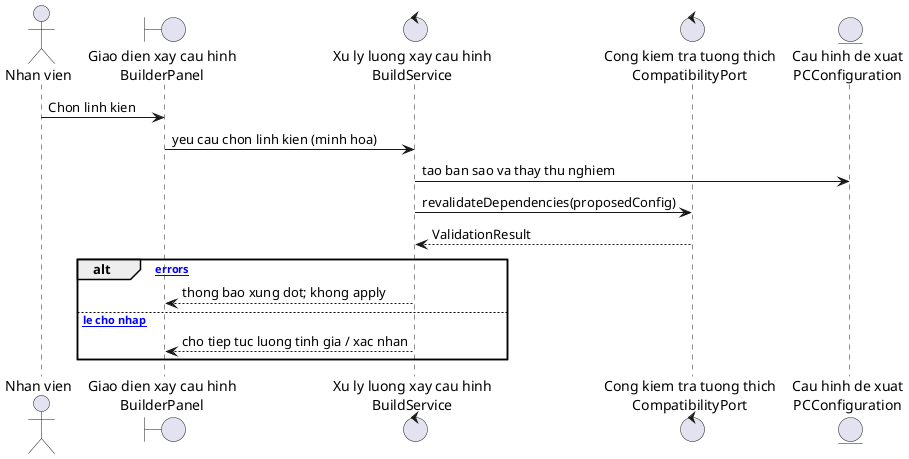

# UML_NAMING_CONVENTION — Quy ước đặt tên UML, Java và MySQL

> **PCInventory · v1.0 · 04/11/2026.** Dùng khi xây dựng Use Case, Sequence Diagram, Class Diagram, mã nguồn Java và tài liệu dự án.
>
> **Trạng thái:** Chuẩn trình bày **đề xuất để nhóm duyệt**. Giữ nguyên các quyết định đã chốt ở *Tài liệu lưu hành nội bộ v0.11 — Design Contract v1*; không tự đổi tên class/method hoặc schema đã được nhóm sử dụng.

## 1. Mục tiêu và nguyên tắc xuyên suốt

Nhóm có 6 thành viên và nhiều sơ đồ được dựng trước khi lập trình. Mục tiêu là **giải thích nghiệp vụ bằng tiếng Việt dễ hiểu** mà không làm gãy tên kỹ thuật mà Java/SQL phải gọi chính xác.

1. **Một khái niệm, một định danh kỹ thuật chuẩn:** bảng SQL, kiểu Java, message API/contract giữ nguyên tên đã khóa.
2. **Tên Việt không dấu là *nhãn diễn giải*, không phải tên vật lý:** ví dụ `ton_kho` để hiểu `stock_balance`; không tạo bảng thứ hai tên `ton_kho`.
3. **Trong UML thể hiện cả hai tầng:** nhãn Việt không dấu dễ hiểu + tên kỹ thuật thật, đặc biệt tại lifeline và các message quan trọng.
4. **Không Việt hóa chữ ký method đã thống nhất:** chỉ chú thích ý nghĩa, không đổi `revalidateDependencies()` thành `kiemTraLaiPhuThuoc()` trong Sequence Diagram khi code vẫn gọi tên cũ.
5. **Tôn trọng người phụ trách:** Đức/Hảo/Hoàng/Nga có thể giữ tên form cũ trong sơ đồ; việc đổi tên lớp thật phải do chủ module đồng ý. Không tạo bản class trùng tên khác ngôn ngữ.
6. **Không bổ sung dữ liệu không tồn tại:** ví dụ `pc_configuration.version` chưa có trong `schema_v1.sql`; vẽ revision chỉ khi nhóm chốt cơ chế thực tế.

## 2. Quy ước đặt tên theo từng lớp

| Đối tượng | Tên dùng cho code/SQL (bắt buộc khớp thực tế) | Nhãn tiếng Việt không dấu (diễn giải) | Ví dụ |
|---|---|---|---|
| MySQL table, column, constraint | `snake_case`, giữ nguyên DDL | `snake_case` Việt không dấu trong tài liệu hoặc `AS` | `stock_balance` / `ton_kho`; `quantity_on_hand` / `so_luong_ton` |
| Java class / interface / enum | `PascalCase` tiếng Anh | nhãn riêng ở UML, không đổi lớp thật | `PCConfiguration` / `Cau hinh PC`; `CompatibilityPort` / `Cong kiem tra tuong thich` |
| Java method, variable, field | `camelCase` | mô tả Việt trong note hoặc message phụ | `validateFinal()` / `Kiem tra cau hinh cuoi` |
| Java constant / enum value | `UPPER_SNAKE_CASE` theo contract | diễn giải bên cạnh | `COMPONENT_TYPE`, `CPU_COOLER`, `CASE_FAN` (tùy enum thật) |
| Package Java | `lowercase`, phân tầng theo module | không phiên âm package | `pcinventory.ui.builder`, `pcinventory.dao` |
| UML actor / tiêu đề UC | Tiếng Việt **có dấu** hoặc không dấu nếu công cụ hạn chế | tên actor nghiệp vụ | `Nhân viên`, `Nhan vien` |
| UML lifeline | đối tượng có định danh kỹ thuật thực | hiển thị nhãn Việt + tên lớp thật | `Kiem tra tuong thich\nCompatibilityService` |
| UML message | chữ ký thật ở điểm giao tiếp ổn định | chú thích tự nhiên nếu cần | `revalidateDependencies(proposedConfig)` |
| File tài liệu | `UPPER_SNAKE_CASE.md` hoặc theo mã UC | tiêu đề thân thiện | `DATA_DICTIONARY_VI.md` |
| PlantUML source | theo mã UC + phiên bản khi đang sửa | một bản canonical khi chốt | `SD_UC28.puml`, lưu bản cũ trong `archive/` |

**Lưu ý:** dấu tiếng Việt vẫn dùng bình thường ở nội dung diễn giải (Markdown, giao diện, báo cáo). Yêu cầu “không dấu” áp dụng cho **nhãn alias chuẩn** để tránh xung đột font/phân tích tự động, không có nghĩa phải bỏ dấu khỏi mọi văn bản.

## 3. Bảng thuật ngữ thống nhất giữa các module

| Khái niệm | Tên kỹ thuật chuẩn / nơi dùng | Nhãn Việt không dấu | Đừng nhầm với |
|---|---|---|---|
| Linh kiện | `Component` (Java), `component` (SQL) | `linh_kien` | dòng tồn kho |
| Loại linh kiện kỹ thuật | `ComponentType`, `component.component_type` | `loai_ky_thuat` | `component_category` |
| Danh mục linh kiện | `component_category` | `danh_muc_linh_kien` | enum `ComponentType` |
| Tồn kho hiện tại | `StockBalance`, `stock_balance` | `ton_kho` | `stock_movement` |
| Lịch sử kho | `stock_movement` | `bien_dong_kho` | số lượng tồn hiện tại |
| Cấu hình PC | `PCConfiguration`, `pc_configuration` (khi đã lưu) | `cau_hinh_pc` | đối tượng `BuildContext` đang làm việc |
| Dòng cấu hình | `ConfigurationItem`, `configuration_item` (khi đã lưu) | `chi_tiet_cau_hinh` | cấu hình tổng |
| Ngữ cảnh Builder | `BuildContext` | `trang_thai_dang_xay_dung` | bản đã lưu trong MySQL |
| Bản dự kiến thay đổi | `proposedConfig` | `cau_hinh_de_xuat` | cấu hình đã apply |
| Kết quả tương thích | `ValidationResult` | `ket_qua_tuong_thich` | `StockCheckResult` |
| Lỗi/tồn đọng chưa thể kiểm | `errors`, `pendingChecks` | `loi`, `cho_kiem_tra` | lỗi đã xác định |
| Loại bị ảnh hưởng | `affectedTypes` | `nhom_bi_anh_huong` | lệnh tự xóa linh kiện |
| Giá đang làm việc | working price | `gia_dang_lam_viec` | `saved_unit_price` |
| Giá snapshot đã lưu | `saved_unit_price` | `gia_luc_luu` | `current_unit_price` |
| Giá snapshot khi lắp | `assembly_unit_price` | `gia_luc_lap` | giá cấu hình đã lưu |
| PC thành phẩm | `AssembledPC`, `assembled_pc` | `pc_thanh_pham` | cấu hình chưa lắp |

## 4. Cách viết lifeline và message trong Sequence Diagram

### 4.1. Mẫu PlantUML giữ tên hiển thị hai tầng



> Message “yeu cau chon linh kien (minh hoa)” **chỉ minh họa thao tác**, chưa phải tên method Java được chốt. Khi chuyển sơ đồ sang bản triển khai, thay bằng tên controller/service thật do Hùng sở hữu. Ngược lại, `revalidateDependencies(proposedConfig)` là tên hợp đồng phải giữ nguyên.

### 4.2. Quy tắc bắt buộc cho mũi tên

- Ở **ranh giới module**, viết `object -> object : methodName(params)` đúng method đã thống nhất.
- Ở bước nghiệp vụ của actor/UI, cho phép Việt không dấu kiểu `Chon linh kien`, `Xac nhan dieu chinh`.
- Return nên ghi rõ **kiểu/ý nghĩa**, ví dụ `ValidationResult(errors, pendingChecks, affectedTypes)` thay vì chỉ `OK`.
- Dùng `alt [co errors]` / `else [chi co pending]` / `else [valid]`; dùng `loop` cho danh sách dòng/số lượng; không biến `pendingChecks` thành lỗi đã xác định trong cấu hình nháp.
- Đừng vẽ DAO truy vấn DB bên trong `CompatibilityService`: **DAO đọc dữ liệu trước, service chỉ tính trên đối tượng đã nạp**.
- Không vẽ **hai lần `applyTogether()`** cho một lựa chọn. Tính giá và revalidate thành công, kiểm tra revision hợp lệ, rồi mới apply đúng một lần.
- Không nhầm biểu diễn UML `boundary/control/entity` với yêu cầu sinh thêm Java class có tên tiếng Việt.

## 5. Hợp đồng không được đổi tên khi Việt hóa

### 5.1. CompatibilityPort (đã chốt Trường–Hùng)

```java
List<Component> filterCompatible(
    PCConfiguration config,
    ComponentType targetType,
    List<Component> candidates
);
ValidationResult revalidateDependencies(PCConfiguration config);
ValidationResult validateFinal(PCConfiguration config);
```

- `filterCompatible`: **loc_ung_vien_tuong_thich** (không tự đọc MySQL/không lọc tồn kho).
- `revalidateDependencies`: **kiem_tra_lai_phu_thuoc** trên cấu hình đề xuất, không sửa nó.
- `validateFinal`: **kiem_tra_cuoi** trên cấu hình đầy đủ; không được còn `errors` hay `pendingChecks` bắt buộc.

**Không dùng** `kiemTraTuongThich()` trong Sequence Diagram thay tên ba method trên khi chưa có thay đổi contract được duyệt.

### 5.2. Luồng Builder và giá (đã chốt Trường–Hùng)

```text
BuildContext (ban goc)
  -> proposedConfig (ban sao / thay thu)
  -> CompatibilityPort.revalidateDependencies(proposedConfig)
  -> PriceCalculator (chinh sach gia phu hop)
  -> kiem tra snapshot/revision
  -> applyTogether(...) dung mot lan
```

- `SELECTION_CHANGE`: giá làm việc cũ được giữ trên dòng không đổi; giá hiện hành áp cho dòng mới/được chỉnh.
- `REFRESH_ALL`: làm mới giá của mọi dòng.
- Nếu có lỗi ở bất kỳ bước nào: giữ nguyên `BuildContext` và tổng tiền cũ.
- Các bước ví dụ `PriceCalculator`, `applyTogether` theo hợp đồng hiện có; không tự tạo class tiếng Việt tương đương.

### 5.3. UC43, UC44 và UC42: cùng từ vựng nhưng khác trách nhiệm

| UC | Nhãn Việt không dấu | Trách nhiệm thực | Không được làm |
|---|---|---|---|
| UC43 (Trường) | `kiem_tra_cau_hinh_cuoi` | `CompatibilityPort.validateFinal()` trả tình trạng hoàn chỉnh/tương thích | kiểm kho, trừ kho hoặc đổi giá |
| UC44 (Trường) | `kiem_tra_ton_truoc_lap` | gộp nhu cầu theo `componentId`, đọc stock và trả đủ/thiếu/không xác minh | giữ hàng, trừ hàng, quản lý revision thay BuildController |
| UC42 (Hoàng) | `lap_rap_pc` | transaction tái kiểm tồn, trừ tồn, tạo PC và biến động | tin kết quả UC44 như đảm bảo tồn vĩnh viễn |

**Quy tắc revision:** Builder có revision do Hùng quản lý; cấu hình đã lưu do Hảo sở hữu và schema hiện **chưa có** cột `version`. Mọi phương thức như `currentRevision()` trong SD đang là đề xuất phải xác định nguồn hiện thực, không được coi là có sẵn.

## 6. Ranh giới UC có chung dữ liệu nhưng không trùng trách nhiệm

| UC / chủ sở hữu | Nhiệm vụ | Dữ liệu tham gia |
|---|---|---|
| UC10 — Hảo | danh sách/catalog linh kiện, tên, mã, giá, thông số | `component` + `*_spec` + `brand`/`component_category` khi cần |
| UC13 — Hùng | lọc linh kiện theo tiêu chí; **nếu dùng trong Builder** mới gọi compatibility | `ComponentDAO` và `CompatibilityPort` theo ngữ cảnh |
| UC22 — Hoàng | số lượng tồn, theo dõi hàng còn bao nhiêu | `stock_balance` + `component` để đặt tên |
| UC44 — Trường | so sánh **nhu cầu của cấu hình** với số lượng kho hiện có | snapshot items + tồn theo `componentId` |

Ví dụ: linh kiện còn trong catalog nhưng `quantity_on_hand=0` vẫn có thể xuất hiện ở UC10; UC22 thể hiện kho đang hết; UC13 áp tiêu chí lọc, UC44 quyết định số lượng có đủ cho một cấu hình cụ thể hay không. Không tách thành hai bảng `component` khác nhau.

## 7. Tên Java cũ trong sơ đồ của các thành viên

- Các sơ đồ Đức/Hảo có thể đang dùng `frmDangNhap`, `frmChinh`, `LinhKienDAO`, `ThemLinhKienAction`. Đó là tên trong tài liệu thành viên; **không tự thay bằng** `LoginFrame`, `MainFrame`, `ComponentDAO` nếu chưa được họ chốt.
- Skeleton hiện có `pcinventory.ui.MainFrame` và `DBConnection`. Nếu một sơ đồ dùng `frmChinh`, ghi note `frmChinh (de xuat tich hop voi MainFrame)` và phân công người quyết định thay vì khẳng định hai tên tương đương trong code.
- Sơ đồ Hảo có thể dùng form chi tiết cấu hình, nhưng khi sửa cấu hình đã lưu (UC40), cần phối hợp CompatibilityPort và xác nhận snapshot giá, không nhân bản thuật toán tương thích.
- Class Diagram và Sequence Diagram sau khi chốt phải ghi một class có một tên kỹ thuật canonical và một chủ sở hữu; sự khác biệt Việt/Anh thuộc **nhãn hiển thị**, không phải lớp thứ hai.

## 8. Quy ước file, phiên bản và kiểm tra cho agent

**Cấu trúc file đề xuất:**

```text
docs/
  DATA_DICTIONARY_VI.md
  UML_NAMING_CONVENTION.md
uml/
  canonical/
    SD_UC28.puml
    SD_UC28.png
  archive/
    SD_UC28_pre_contract.png
```

Đường dẫn `uml/` là **đề xuất tương lai**, chưa khẳng định đang tồn tại trên GitHub. Không tự di chuyển/xóa file của các thành viên nếu không có phê duyệt.

**Checklist trước khi khóa một Sequence Diagram:**

- [ ] Lifeline quan trọng có tên kỹ thuật thật và nhãn giải thích bằng tiếng Việt không dấu.
- [ ] Message qua ranh giới module có đúng class/method/kiểu trả về trong hợp đồng.
- [ ] Tên bảng/cột trong DAO/SQL khớp `schema_v1.sql`, không dùng alias Việt như tên DB thật.
- [ ] Các nhánh `alt/opt/loop` mô tả rõ thành công, thất bại, dữ liệu thiếu và giữ trạng thái cũ.
- [ ] Giá, tồn, snapshot, revision không gộp nhầm trách nhiệm giữa Hùng, Trường, Hảo, Hoàng.
- [ ] Không giả định tồn tại `version` ở bảng `pc_configuration`.
- [ ] Đã phân biệt quyết định **đã chốt** với đề xuất **cần chủ UC xác nhận**.
- [ ] Có source `.puml`, export PNG/SVG và ghi `CHANGELOG` nếu có sửa logic.

## 9. Chỉ dẫn khi thay đổi quy ước sau này

Mọi yêu cầu đổi tên kỹ thuật thật (Java class/method, SQL table/column, enum) cần: liệt kê nơi tham chiếu → người sở hữu đồng ý → sửa Design Contract nếu liên quan → cập nhật UML, DAO/Service, test, migration (nếu đổi SQL) → reviewer xác nhận. Việc đổi **nhãn Việt hóa** chỉ cần sửa hai tài liệu chú giải.

**Tài liệu đối chiếu:** [DATA_DICTIONARY_VI.md](DATA_DICTIONARY_VI.md), [`database/schema_v1.sql`](../database/schema_v1.sql), *Tài liệu nội bộ v0.11 / Design Contract v1*, *PCInventory Sequence Diagram Revision Plan v2*.